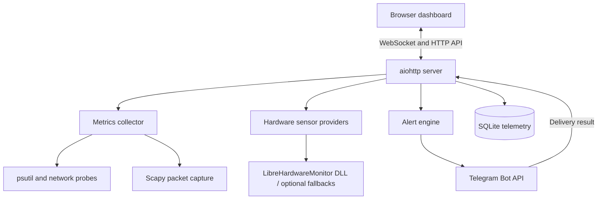

# NetPulse

**Real-time network and hardware monitoring for your PC.**

   

NetPulse is a lightweight, Windows-first monitoring dashboard developed by **Group 15** for the *Network Developing* class. It helps you understand network activity, inspect hardware health, track incidents and receive Telegram alerts from a single local web interface.

## Contents

- [Features](#features)
- [Quick start](#quick-start)
- [Using the dashboard](#using-the-dashboard)
- [Telegram notifications](#telegram-notifications)
- [Data storage and privacy](#data-storage-and-privacy)
- [Architecture](#architecture)
- [Build a Windows executable](#build-a-windows-executable)
- [Troubleshooting](#troubleshooting)
- [Limitations](#limitations)
- [Team](#team)

## Features

| Area | Capabilities |
| --- | --- |
| Network | Live download/upload, bandwidth chart, daily/weekly/monthly usage, network interfaces, Wi-Fi and IP configuration |
| Traffic analysis | Per-application and per-service bandwidth, active TCP/UDP connections, packet errors and drops |
| Connection quality | ICMP ping, jitter, packet loss, quality score, observed Internet uptime |
| Diagnostics | Ping, traceroute and DNS lookup |
| Hardware | Grouped CPU, GPU, RAM, storage and other available sensors; hardware inventory |
| Alerts | Instant or sustained thresholds, cooldown, recovery and optional Telegram notifications |
| Event log | Persistent SQLite history, search, filters, acknowledgement, CSV/JSON export and Telegram delivery attempts |

## Quick start

### 1. Requirements

- Windows 10 or 11 recommended.
- [Python 3.10 or newer](https://www.python.org/downloads/) for running from source. Select **Add Python to PATH** during installation.
- A modern web browser.
- [Npcap](https://npcap.com/#download) for optional per-application/service packet capture.
- Compatible .NET Framework runtime (4.8/4.8.1 recommended for the Framework-targeted sensor DLLs) for optional embedded hardware sensors.
- Administrator privileges recommended for packet capture and advanced hardware readings.

Basic monitoring does not require Npcap, Telegram or a separate database server.

### 2. Download the project

Download the project ZIP from GitHub or obtain the full source archive. Extract it to a folder of your choice. Open the folder containing `app.py` and `requirements.txt` in PowerShell.

### 3. Install dependencies

```powershell
py --version
py -m pip install -r requirements.txt
```

Optional: use an isolated Python environment instead of installing dependencies globally:

```powershell
py -m venv .venv
.\.venv\Scripts\python.exe -m pip install -r requirements.txt
.\.venv\Scripts\python.exe app.py
```

### 4. Start NetPulse

```powershell
py app.py
```

Open **http://127.0.0.1:8080** if the browser does not open automatically. If port 8080 is occupied, use the address printed in the terminal (NetPulse tries ports 8080–8099).

Keep the terminal open while monitoring. Press `Ctrl+C` to stop. Use `py app.py --no-browser` to disable automatic browser launch.

### 5. Enable optional monitoring features

**Advanced hardware sensors:** The full source distribution includes DLLs in `libs/`. Keep them together. If they are absent in another distribution, obtain the compatible .NET Framework build from the official [LibreHardwareMonitor releases](https://github.com/LibreHardwareMonitor/LibreHardwareMonitor/releases) and copy the library, matching dependencies and license notices into `libs/`. Do not mix DLLs from different releases or runtime targets. Close the standalone LibreHardwareMonitor application and run NetPulse as administrator. The embedded provider does not require a separate GUI or HTTP server. HTTP/WMI are optional fallback sources.

**Application traffic:** Install Npcap, then reopen PowerShell as administrator and start NetPulse again. Scapy captures packets and attributes traffic using ports and process information. Basic bandwidth monitoring continues without capture.

## Using the dashboard

| Tab | What to do |
| --- | --- |
| Overview | Check overall system health, network throughput and connection status. |
| Traffic analytics | Inspect bandwidth, usage totals, network quality, interfaces, Wi-Fi, application/service traffic and active connections. Run diagnostics when troubleshooting. |
| Hardware | Inspect grouped components and available sensors. Configure thresholds and test Telegram delivery. |
| Devices | Inspect the available device and hardware inventory. |
| Event log | Review incidents and delivery attempts, search or filter events, acknowledge reviewed records and export matching history. |

Traffic history starts when the updated application runs. Week totals begin on Monday; month totals begin on the first day of the month. Uptime measures successful public TCP probes during observed runtime, not ISP availability while the application is closed. The quality score is a NetPulse heuristic, not an industry standard.

## Telegram notifications

Telegram is optional. To receive private alerts:

1. Open [@BotFather](https://t.me/BotFather) in Telegram, send `/newbot` and follow the instructions to create a bot.
2. Open your new bot's chat and send `/start`.
3. Obtain your private chat ID from the Telegram Bot API `getUpdates` response (`message.chat.id`). Use the official [Bot API documentation](https://core.telegram.org/bots/api#getupdates). Keep the token private, including in URLs and screenshots.
4. In the PowerShell session used to launch NetPulse, set the following variables using your own values:

```powershell
$env:TELEGRAM_BOT_TOKEN = "YOUR_BOT_TOKEN"
$env:TELEGRAM_CHAT_ID = "YOUR_PRIVATE_CHAT_ID"
py app.py
```

5. Open **Hardware → Send Telegram test**. Confirm that a message arrives and review the **Event log**.
6. Configure alert thresholds and select **Save thresholds**.

Instant alerts trigger on crossing a threshold; sustained alerts require the condition to persist for the configured duration. Cooldown reduces repeated alerts, and recovery messages indicate a return to normal. Delivery attempts are logged, with up to three attempts per notification. A timeout can occasionally cause duplicate messages.

PowerShell variables above apply to the current session. For persistent setup, use Windows user environment variables and reopen the terminal. `.env` files are not automatically loaded. Never commit bot credentials to Git. Keep NetPulse running to receive alerts.

## Data storage and privacy

NetPulse stores data locally in your user profile:

| File | Purpose |
| --- | --- |
| `%USERPROFILE%\.netpulse\telemetry.sqlite3` | Events, acknowledgements, daily traffic totals and observed uptime |
| `%USERPROFILE%\.netpulse\alert_config.json` | Saved alert thresholds |

SQLite is included with Python; no database installation is needed. History persists across restarts. The event list displays up to 500 matching records; exports support up to 100,000. Automatic log retention is not implemented. Stop NetPulse before backing up or moving its database files.

The dashboard binds to localhost (`127.0.0.1`). Network probes and diagnostics contact external targets such as Cloudflare, Google and DNS resolvers. If enabled, Telegram sends alert content (including host name and measured values) to Telegram. The telemetry database is not designed to store bot credentials or packet payloads. Do not expose the local server to the Internet without adding authentication and transport security.

## Architecture



### Project structure

```text
LTM-Group15/
├── app.py                 # HTTP server, WebSocket and monitoring loop
├── collector.py           # Real-time system and network metrics
├── traffic.py             # Packet capture and traffic attribution
├── hardware.py            # Hardware inventory and GPU monitoring
├── sensors.py             # Sensor providers and normalization
├── embedded_sensors.py    # Python.NET integration with sensor DLL
├── observability.py       # SQLite, network diagnostics and event API
├── alerts/                # Threshold engine and Telegram client
├── libs/                  # Embedded sensor libraries
├── static/                # HTML, CSS and JavaScript dashboard
├── requirements.txt       # Runtime dependencies
├── build.bat              # Windows executable build script
└── .github/workflows/     # GitHub Actions build workflow
```

**Technology stack:** Python, aiohttp, WebSocket, psutil, Scapy, Python.NET, LibreHardwareMonitor, SQLite, HTML, CSS and JavaScript.

## Build a Windows executable

From the project folder on Windows, run:

```powershell
.\build.bat
```

The script installs build dependencies and uses PyInstaller to produce `dist\NetPulse.exe`. The local build includes `static/` and `libs/`. If a compatible executable is published, it can also be obtained from the [Releases](../../releases) page.

Test the executable on the target Windows PC before distributing it. Npcap, compatible .NET runtime and administrator permissions may still be required for optional features. Only run executables from trusted sources.

## Troubleshooting

| Problem | What to check |
| --- | --- |
| `py` is not recognized | Install Python with the Windows launcher and reopen PowerShell. |
| `ModuleNotFoundError` | Run `py -m pip install -r requirements.txt` using the same interpreter used to start the app. |
| Dashboard does not open | Check the printed localhost address and terminal errors. |
| Tabs or UI appear outdated | Press `Ctrl+F5` and verify that all files in `static/` come from the same version. |
| CPU/GPU/SSD sensor is `N/A` | Check DLL compatibility, .NET runtime, administrator rights and hardware support. |
| No per-application traffic | Install Npcap and run as administrator. |
| Telegram test fails | Verify token, chat ID, `/start`, Internet access and environment variables; inspect Event log. |
| Ping or Wi-Fi details missing | Check Windows permissions, command availability, output language and ICMP restrictions. |
| History is empty | Allow the app to collect new samples and verify that the user profile is writable. |

## Limitations

- Windows-first; other platforms have reduced hardware and Wi-Fi support.
- Sensor availability depends on drivers, hardware, privileges and compatible DLLs. Missing measurements may appear as `N/A`.
- Packet attribution is best effort; short-lived connections may be unattributed, and capture may increase CPU usage.
- ICMP parsing depends on system command output; blocked ICMP does not necessarily mean the Internet is down. Diagnostics currently use fixed targets.
- Event logging covers instrumented errors and incidents, not every internal library error. Acknowledgement marks review, not resolution.
- History is collected only while NetPulse runs. Alert state resets on restart.
- Local single-machine educational project; no remote agent or multi-device management yet.
- Full Windows integration and executable portability should be verified before release.

## Team

**Group 15 — Network Developing class**

| Member | Role |
| --- | --- |
| Lư Hoàng Minh Hiếu | Backend / Agent / Data Collector |
| Đặng Phúc Hải Tịnh | Dashboard / WebSocket / Frontend |

Feedback and bug reports: **netpulsegroup15@gmail.com**. When reporting a problem, include your Windows/Python versions, relevant error output and reproduction steps. Remove credentials and sensitive network information first.

## Acknowledgements

NetPulse uses third-party projects including [aiohttp](https://github.com/aio-libs/aiohttp), [psutil](https://github.com/giampaolo/psutil), [Scapy](https://github.com/secdev/scapy), [Python.NET](https://github.com/pythonnet/pythonnet) and [LibreHardwareMonitor](https://github.com/LibreHardwareMonitor/LibreHardwareMonitor). Their respective license terms apply. Review and include required third-party license notices before redistributing binaries. No project-wide license is declared here.
